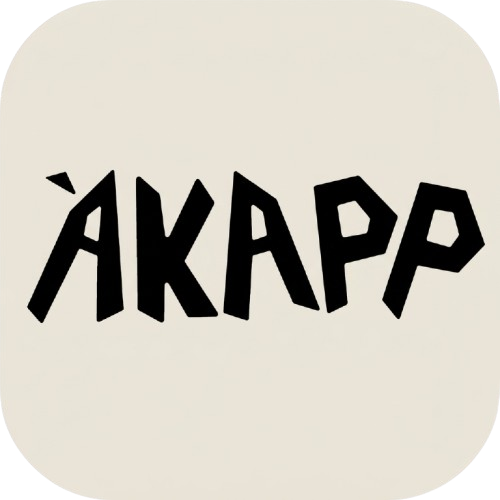
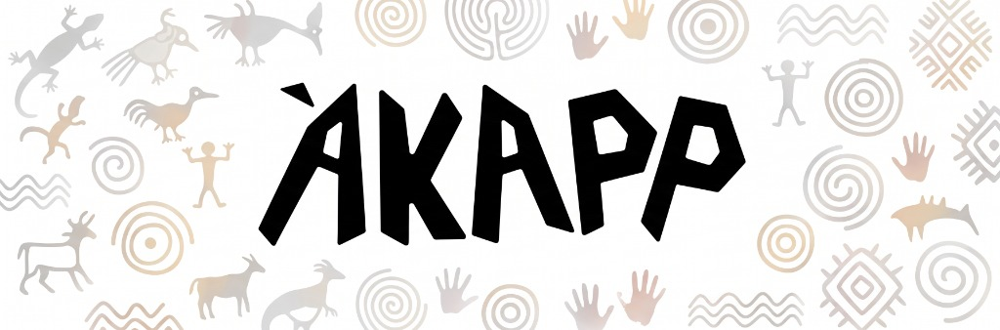

# ENTREGABLE OFICIAL: SPRINTS 01 Y 02 · AKAPP
> **HackaToB 2026 · Costa Rica**  
> **Iniciativa**: Turismo Regenerativo y Senderismo Gamificado en Parques Nacionales  
> **Repositorio Oficial**: [https://github.com/NanuCR/Akapp](https://github.com/NanuCR/Akapp)

---

## Identidad Visual Oficial

| Icono de la App | Banner Oficial con Petroglifos |
| :---: | :---: |
|  |  |

---

# PARTE 1 · SPRINT 01: PROBLEMA Y VIABILIDAD (Definí el Reto)

## 1. El Marco de las 6 Líneas del Reto

1. **La Persona**: Senderistas y turistas (nacionales e internacionales) de 20 a 45 años que recorren los Parques Nacionales de Costa Rica en busca de naturaleza, reto físico y conexión cultural auténtica.
2. **La Fricción**: Viven una experiencia de recorrido pasiva y desconectada: caminan dos horas por el sendero, toman fotos en el mirador y se marchan de inmediato sin interactuar con la cultura del lugar ni consumir en el comercio vecino.
3. **La Consecuencia**: Se profundiza el "turismo de enclave", donde más del 85% del gasto del visitante no llega a las comunidades rurales que custodian las áreas protegidas, mientras los guardaparques lidian con visitantes que abandonan los senderos oficiales buscando novedades.
4. **La Oportunidad**: El visitante contemporáneo busca experiencias interactivas y turismo con propósito; incentivar el respeto a los senderos oficiales mediante dinámicas digitales genera un puente directo de consumo hacia los pueblos vecinos.
5. **La Propuesta (Akapp)**: Una aplicación móvil offline-first que convierte el sendero oficial en una búsqueda de **Piedras Àk** geolocalizadas, premiando cada tramo con **Tsirö** (granos de cacao ancestrales) canjeables exclusivamente en sodas, cafeterías, posadas y guías locales acreditados.
6. **La Transformación**: El caminante disfruta de una aventura enriquecida y cultural; el parque protege sus ecosistemas canalizando el flujo de visitantes; y los comercios rurales reciben una derrama económica directa y medible.

---

## 2. ¿Qué gana el SINAC (Sistema Nacional de Áreas de Conservación)?

* **Apego estricto a senderos oficiales**: Las Piedras Àk están ubicadas únicamente sobre las trazas autorizadas por el SINAC (Poás, Tenorio, Tapantí), desincentivando rutas ilegales y protegiendo la flora del pisoteo.
* **Ciencia ciudadana georreferenciada sin costo**: Los senderistas reportan avistamientos de fauna clave (danta, quetzal, perezoso) con coordenadas GPS exactas, enriqueciendo los inventarios biológicos del parque.
* **Monitoreo acústico ambiental**: Función de captura de 5 segundos de audio para alimentar estudios de bioacústica y detección temprana de anomalías sonoras en el bosque.
* **Interpretación ambiental sin infraestructura invasiva**: La app actúa como guía de campo digital, reduciendo la necesidad de colocar vallas físicas en el entorno natural.

---

## 3. ¿Qué ganan los Negocios Locales (Sodas, Posadas y Guías Comunitarios)?

* **Tráfico de clientes con alta intención de consumo**: Los turistas salen del sendero con saldo acumulado en Tsirö que solo pueden canjear en los comercios aliados alrededor del parque.
* **Cero costo de adquisición de clientes (CAC)**: El comercio no paga comisiones adelantadas a intermediarios; solo valida un beneficio marginal (ej. 10% de descuento o café de cortesía) a cambio de clientes nuevos sentados a la mesa.
* **Visibilidad digital georreferenciada**: Pequeñas sodas tradicionales y posadas familiares quedan destacadas en el mapa interactivo de Akapp.
* **Formalización de Guías Locales Certificados**: Directorio directo con guías acreditados por el ICT, fortaleciendo el empleo local calificado y combatiendo la informalidad.
* **Validación de mercado real**: Directorio construido con **44 establecimientos comerciales en 13 Parques Nacionales** con teléfonos de contacto y guión de llamada para medir adopción inmediata.

---

## 4. Evidencia y Viabilidad Técnica / Económica

* **Datos SINAC / ICT**: Más del 50% de los turistas internacionales visitan al menos un Parque Nacional, pero menos del 15% del gasto turístico diario impacta a los comercios rurales colindantes.
* **Arquitectura Offline-First**: Mapas y coordenadas almacenados en el dispositivo para operar en zonas montañosas sin cobertura celular 4G/5G.
* **Supuesto y Mitigación de Conservación**: La colocación estricta de hitos digitales sobre caminos de OpenStreetMap garantiza que no se promueva el tránsito fuera de sendero.

---

# PARTE 2 · SPRINT 02: PROTOTIPO, DISEÑO Y DESARROLLO (Construí la Primera Versión)

## 1. Flujo Principal (User Journey)
1. **Llegada y Preparación (Off-grid)**: El usuario abre Akapp, consulta la ruta del parque y verifica el perfil de elevación, dificultad, clima y estado offline.
2. **Caminata en Sendero**: El mapa interactivo muestra la posición en la ruta oficial. A medida que avanza, encuentra marcadores de las **Piedras Àk**.
3. **Escaneo del Àk**: Al aproximarse al hito, pulsa "Escanear Àk". Se despliega la animación de revelado de luz líquida, vibración háptica y acumulación de **Tsirö**.
4. **Ficha de Ciencia Ciudadana**: Opcionalmente registra avistamientos de fauna (danta, quetzal, perezoso), fotografía del lugar o muestra acústica para el SINAC.
5. **Canje en la Comunidad**: Al finalizar la caminata, acude a una de las sodas aliadas y canjea su cupón digital mostrando el código en caja.

---

## 2. Ruta de Entrega (Enlaces y Prototipos)

* **Repositorio Oficial de Código**: [https://github.com/NanuCR/Akapp](https://github.com/NanuCR/Akapp)  
  *Stack: React 18, Vite, Tailwind CSS, HeroUI v2 y Leaflet (OpenStreetMap).*
* **Despliegue Continuo en Producción**: Conectado a **Vercel** en la rama `main` para pruebas en navegadores móviles.
* **Demo de Identidad Visual y Animación de Escaneo**: [https://ubiquitous-meringue-1dc77e.netlify.app](https://ubiquitous-meringue-1dc77e.netlify.app)
* **Archivo de Evidencia Comercial**: `directorio_establecimientos_parques_cr.xlsx` en la raíz del repositorio con 44 comercios en 13 parques nacionales.
* **Senderos Georreferenciados Reales**:
  * *Volcán Poás*: Laguna Botos (OSM ways 1368189811 y 37058510).
  * *Volcán Tenorio*: Sendero Misterios del Tenorio a Catarata y Los Teñideros (OSM way 140618307).
  * *Tapantí*: Sendero Oropéndola (OSM way 1199930255).

---

## 3. Revisión Interna (Ajustes Realizados y Qué Falta)

### Ajustes Realizados
1. **Limpieza de Interfaz Principal**: Eliminación del botón redundante de filtro ("Ruta 2h AX") para una cuadrícula simétrica de 2 columnas ("Cerca de mí" y "Con guía hoy"), optimizando la vista móvil.
2. **Precisión de Senderos**: Reubicación de piedras Àk para coincidir exactamente sobre las coordenadas reales de OpenStreetMap.
3. **Sincronización de Elevación**: Coincidencia exacta de los puntos SVG `<circle cx={ak.x} cy={ak.y} />` con la curva topográfica del terreno.
4. **Directorio Colapsable de Guías**: Menú desplegable con iconografía de guardaparque safari para no saturar el mapa.
5. **Accesibilidad**: Áreas táctiles mínimas de 44x44px y contraste tipográfico superior a 4.5:1.

### Qué Falta por Implementar (Próximos Pasos)
1. **Lector Web NFC Nativo**: Lectura automática al acercar el teléfono físico al hito de madera o piedra.
2. **Validación Bidireccional de Cupones**: Código QR dinámico de un solo uso escaneable por el comercio para evitar canjes duplicados.
3. **Sincronización en Nube Automática**: Carga en segundo plano de los reportes de ciencia ciudadana al recuperar señal celular al salir del parque.
